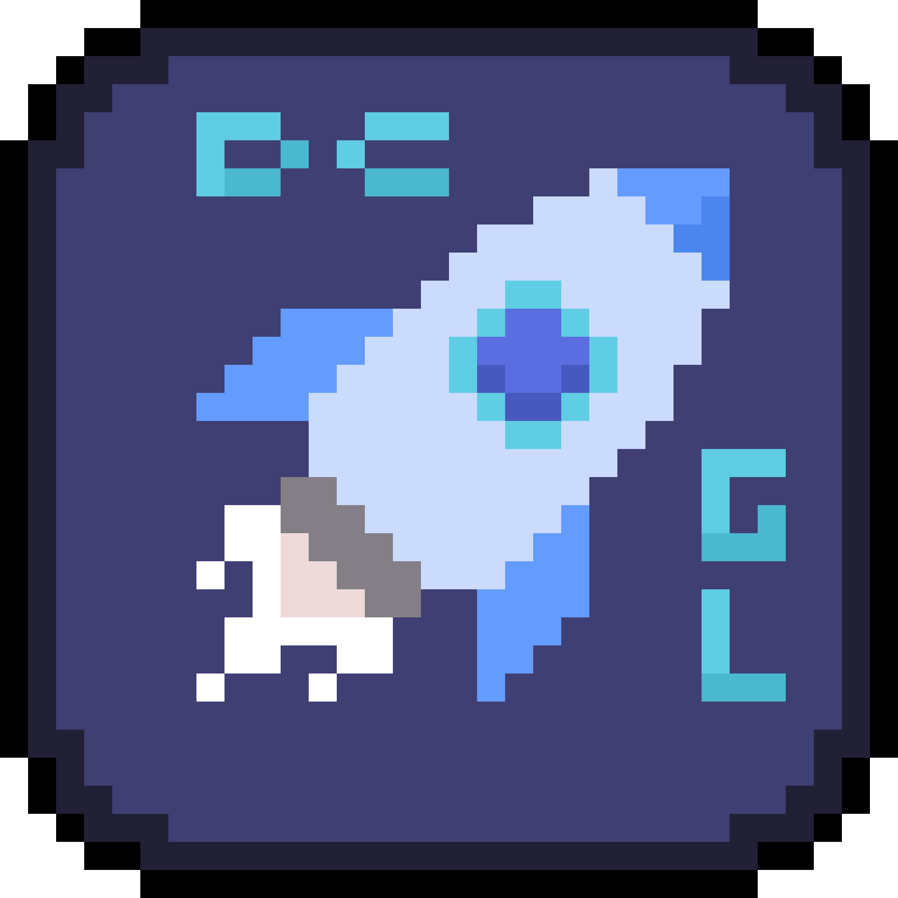
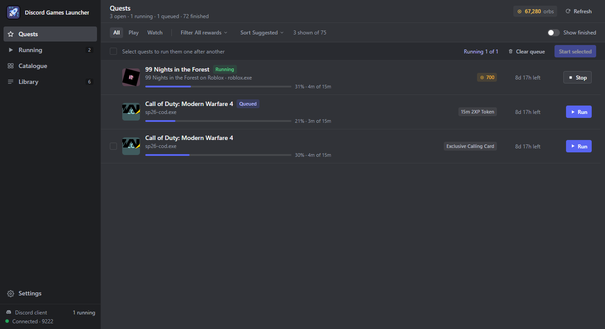
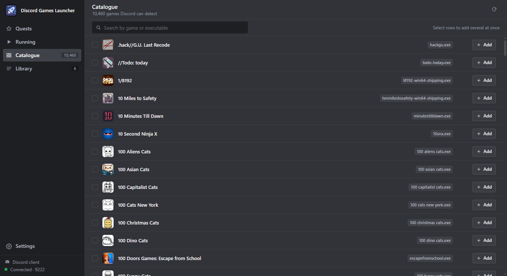
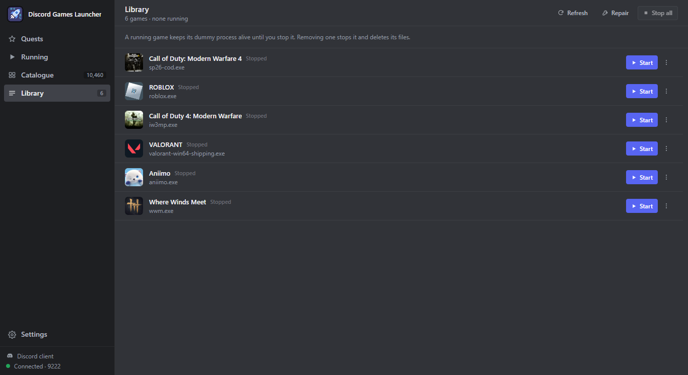
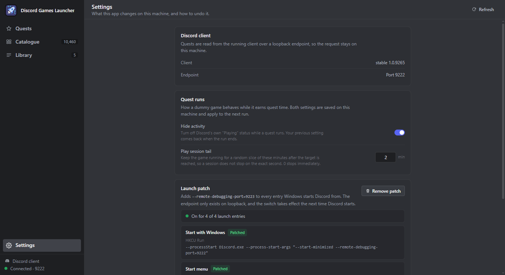
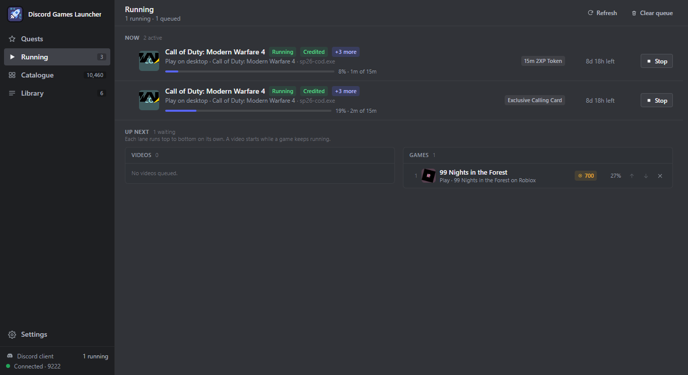

# Discord Games Launcher

A Windows app that starts games in Discord without owning them, and finishes quests from the client you already have open. Library games run as a small dummy process named what Discord looks for; quests need no process at all.

## Screenshots

|  |  |
| --- | --- |
|  |  |

## How it works

Discord scans running processes about every 15 seconds and matches executable names against its own game database. For a library game the launcher supplies what that scan expects:

1. It reads the quest list from the running Discord client over its local DevTools endpoint.
2. It downloads Discord's supported game list, about 20,000 entries, and keeps it in SQLite.
3. It copies a prebuilt dummy executable under the process name the game needs, and starts it.

Discord then shows "Playing <game>" for as long as the process runs. A quest run is different: it posts the same play-time heartbeat Discord's client posts, so no process, window, or library entry is created.

## Quests

The Quests view lists what Discord pays for right now: desktop play quests and video quests, including the ones Discord keys for its phone app. Each row carries the game, its executable, the reward, the time left, and the one button that fits the quest state (Run, Stop, or Watch).

The header shows your current orb balance next to the quest counts. Sort by suggested order, expiry, orbs, or progress, filter by reward and quest type, and tick the rows you want: Start selected accepts the quests you never accepted, runs the play quests one after another, and credits each video quest in the background. Games and videos run in separate lanes, so a video starts while a game keeps running, and a second play quest pressed while one is running joins the queue instead of starting a parallel run. Discord keeps running normally the whole time.

The Running view shows what is in flight: the video being credited, the running play quest, and the queue. Move a queued quest up or down, remove it, or stop a video from its row before it finishes.

Quests are read out of the running client over loopback, so the request never leaves this machine.

A quest only counts after you accept it. Run and Watch accept it first through the running client, so there is no separate Accept step and no Discord window opens. A quest run adds nothing to your library and copies nothing to disk: the play time is reported through the client's own endpoint, with the game shown on your profile or kept private. Dummy windows belong to catalogue games, and they start minimized without taking focus.

If Discord was started without the local endpoint, the view offers one setup that adds the flag to your Discord shortcuts and startup entry. It restarts Discord once, and from then on the list is there every time Discord starts.

Settings also holds the quest options: Play activity chooses whether a run shows the game on your profile or stays private, and the pause between quests, in minutes, spaces finished runs out so they do not follow each other back to back. The same page lists every Discord entry the setup touched, in case you want the switch removed again.

Read [docs/dev/quests.md](docs/dev/quests.md) for how the reading works and where it fails.

## Catalogue

Browse every game Discord can display as activity.

- Search by game name or executable, filtered in SQL as you type.
- 200 games per page, loaded as you scroll, with only the visible rows mounted.
- Select several games and add them together; games you already own are marked and skipped.
- Only games with a Windows build are listed.

## Library

Your games, with the state Discord sees.

- Each row shows running or stopped and the exact process name.
- Start and Stop on the row, plus a menu to remove.
- Tick rows to remove several games at once, or Select all; removal asks first.
- Removal stops the process, deletes the copied executable and its folder, and drops the database entry.
- Repair rebuilds the dummy files for every game, for when a file went missing.

## Detection

Discord scans process names roughly every 15 seconds. A dummy process named `minecraft.exe` is enough for Discord to show "Playing minecraft", using the game ID and assets it already knows.

## Download

Get `dcgl.exe` from [GitHub Releases](https://github.com/x01Jin/discord-games-launcher/releases). There is no installer; the executable is self-contained and the game database fills in on first launch.

## Quick start

1. Start `dcgl.exe`. The first launch downloads the game database.
2. Open Quests and press Run on a quest. The game is added to your library and started for you.
3. To play something else, find it in the Catalogue and press Add.
4. Start and stop it from the Library, or press Stop all.
5. Check Discord: the status appears within about 15 seconds of a process starting.

## Requirements

- Windows 10 or 11, 64-bit
- The Discord desktop app
- 500 MB free disk space
- Internet for the first database sync (about 20,000 games)

## Process lifecycle

Starting a game copies the template executable, renames it to the process name Discord compares against, launches it, and Discord picks it up on its next scan.

Stopping finds the process and its children, ends the children first, then the parent. The dummy window closes and Discord drops the status on its next scan.

Removing a game stops it if needed, deletes its executable and folder, then deletes the database row.

## Limits

- Windows only. Discord's detection works differently on macOS and Linux.
- Only games Discord already knows can be simulated.
- Basic "Playing" status, with no rich presence details.
- The catalogue comes from an undocumented Discord endpoint. Cached data keeps working if it changes.
- Some anti-cheat protected games use process names that cannot be mimicked.

## Documentation

[Documentation index](docs/index.md) covers installation, the bridge, the database, and the quest reader.
